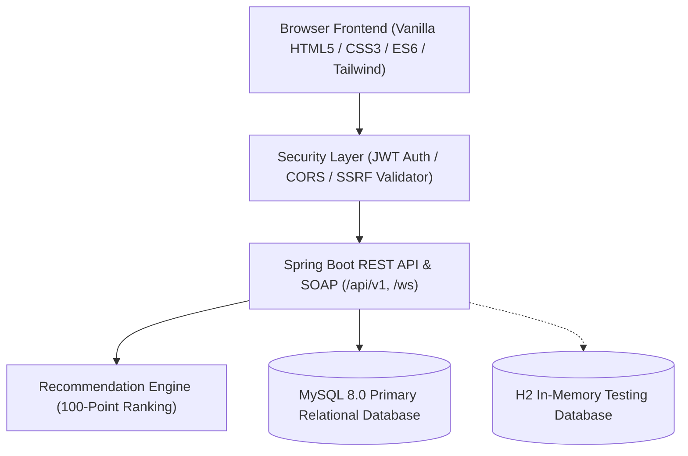

# InChef — Intelligent Indian Recipe Recommendation System

[](https://github.com/CompileWithKrish/InChef-Recipe-Recommendation-System/actions/workflows/build.yml)
[](https://www.oracle.com/java/technologies/javase/jdk17-archive-downloads.html)
[](https://spring.io/projects/spring-boot)
[](https://www.mysql.com/)
[](LICENSE)

> **Cook what you have, love what you eat.**  
> InChef is an intelligent culinary platform designed for Indian and regional cuisine. It bridges the gap between what is inside your kitchen pantry and what you can cook right now, powered by deterministic multi-factor recommendation algorithms, distinct ingredient tokenization, and strict data privacy.

---

## Architecture Overview



---

## Key Features

### 1. Dual-Workflow Culinary Engine
- **Workflow A (Direct Recipe Search):** Instant, case-insensitive partial-match querying over dish titles and translated English titles (e.g. *"Chicken Biryani"*, *"Paneer Butter Masala"*). Fully bypasses ingredient tokenization for lightning-fast search with pagination and cuisine filters.
- **Workflow B (Ingredient-Based Recommendation):** Suggests recipes based on ingredients you have on hand. Normalizes culinary variations, handles aliases (e.g. *Hari Mirch* -> *Green Chilli*, *Curd* -> *Yogurt*), enforces a **75% minimum ingredient match threshold**, and protects against false-positives (e.g. *pea* vs *peanut*, *egg* vs *eggplant*).

### 2. Explainable 100-Point Ranking Formula
Every recommendation includes a transparent score breakdown:
- **Ingredient Coverage (60 pts):** Proportion of required dish ingredients available.
- **Dietary Preference Alignment (15 pts):** Strict match for Vegetarian, Non-Vegetarian, or Vegan diets.
- **Cuisine Preference Alignment (10 pts):** Match with user's preferred regional cuisines.
- **Time Convenience (10 pts):** Boost for dishes fitting user's maximum preparation time.
- **Meal Course Fit (5 pts):** Match for Breakfast, Lunch, Dinner, Snack, or Dessert.
- **Allergy Guard:** Non-bypassable constraint that completely excludes dishes containing allergens.

### 3. Kitchen Pantry & Digital Inventory
- Track pantry items with exact quantities and standardized measurement units (`GRAMS`, `KILOGRAMS`, `TABLESPOONS`, `CUPS`, `PIECES`).
- 1-click option to calculate recommendations directly against your stocked pantry.

### 4. User Preferences & Login History
- Multi-cuisine selection stored cleanly as JSON arrays (e.g. `["North Indian", "South Indian"]`).
- Dedicated **Login History** section in user profile displaying recent authentication events, timestamps, authentication method (`PASSWORD` vs `GOOGLE_OAUTH`), and success status.

### 5. Multi-Strategy Recipe Image Engine
- Strategy A: Scraped high-res image from source recipe portal.
- Strategy B: Google Custom Search API integration for authenticated image retrieval.
- Strategy C: Web crawl with OpenGraph / JSON-LD metadata extraction.
- Strategy D: Clean, standardized neutral SVG fallback (`neutral_recipe_placeholder.svg`).
- Embedded **SSRF Validator** blocks internal loopback and cloud metadata requests.

---

## Technology Stack

- **Backend:** Java 17 LTS, Spring Boot 3.3.4, Spring Data JPA, Hibernate ORM 6.5.3, Spring Security, Spring WS (SOAP).
- **Database:** MySQL 8.0 (Production / Dev), H2 In-Memory (Automated Testing).
- **Frontend:** Vanilla HTML5, Modern CSS3 (CSS Variables, Flexbox/Grid), Vanilla ES6 JavaScript, Tailwind CSS (via CDN). No React or Node.js runtime required.
- **Build & CI/CD:** Apache Maven 3.9.6, GitHub Actions CI.
- **Containerization:** Docker & Docker Compose for standardized MySQL 8 local environments.

---

## Repository Structure

```text
inchef/
├── .github/workflows/build.yml        # GitHub Actions CI workflow (JDK 17 + H2)
├── pom.xml                            # Maven project definition
├── mvnw / mvnw.cmd                    # Cross-platform Maven wrappers
├── .gitignore                         # Comprehensive ignore rules
├── .gitattributes                     # Cross-platform line-ending normalization
├── .env.example                       # Sanitized environment template
├── docker-compose.yml                 # Standalone MySQL 8 container service
│
├── docs/                              # Technical Documentation
│   ├── architecture.md                # System architecture & package design
│   ├── database-schema.md             # MySQL relational schema, entities, indexes
│   ├── api-documentation.md           # REST (/api/v1) and SOAP (/ws) API reference
│   ├── recommendation-engine.md       # 100-point algorithm and 75% coverage logic
│   ├── image-retrieval-engine.md      # Multi-strategy image extraction & SSRF rules
│   ├── setup-guide.md                 # Detailed local setup walkthrough
│   ├── deployment.md                  # Docker & production operations guide
│   └── repository-restructure-plan.md # Architectural restructuring record
│
├── data/                              # Datasets & Migrations
│   ├── README.md                      # Dataset schema and usage guide
│   ├── LICENSES.md                    # Data licensing & attribution
│   ├── samples/                       # Verified sample datasets for CI/testing
│   │   └── sample_recipes.xlsx        # 10-row sample of Indian Food Dataset
│   ├── processed/                     # Production CSV tables
│   └── migrations/                    # Versioned SQL migration scripts
│
├── scripts/                           # Operational & CLI Management Scripts
│   ├── README.md                      # CLI usage guide
│   ├── import_dataset.py              # Resumable, idempotent dataset importer
│   ├── audit_dataset.py               # Dataset profiling & anomaly detection
│   ├── audit_database.py              # Database table, row, and index auditor
│   └── audit_recipe_images.py         # Recipe image reachability & coverage auditor
│
├── src/main/java/com/inchef/          # Modular Spring Boot Application
│   ├── InChefApplication.java         # Main Spring Boot entrypoint
│   ├── auth/                          # Authentication, JWT, Google OAuth
│   ├── user/                          # User account management
│   ├── preference/                    # User dietary & cuisine preferences
│   ├── loginhistory/                  # Login audit history entity, service, controller
│   ├── ingredient/                    # Canonical ingredient dictionary
│   ├── pantry/                        # Kitchen inventory management
│   ├── favorite/                      # User saved favorite recipes
│   ├── recipe/                        # Recipe catalog, ingredients, cooking progress
│   ├── recommendation/                # 100-point ranking engine & service
│   ├── recipeimage/                   # Image resolution, crawler, audit, proxy
│   ├── dataset/                       # Sample data bootstrapper (DataInitializer)
│   ├── soap/                          # SOAP report endpoints and models
│   ├── common/                        # Shared responses, units, SSRF validator
│   ├── config/                        # Security, CORS, WebService configurations
│   ├── security/                      # JWT filter, token provider, security utils
│   └── exception/                     # Global exception handler & error response
│
├── src/main/resources/static/         # Vanilla Web Frontend
│   ├── index.html                     # Hero & landing page
│   ├── discover.html                  # Recipe discovery & search interface
│   ├── recommendations.html           # Ingredient recommendation interface
│   ├── recipe_details.html            # Detailed recipe view & cooking steps
│   ├── my_kitchen.html                # Digital pantry management
│   ├── favorites.html                 # Saved favorite recipes
│   ├── profile.html                   # Preferences & Login History
│   ├── auth.html                      # Unified login and signup interface
│   ├── login.html / signup.html       # Route aliases to auth.html
│   ├── css/                           # Global, component, and responsive styles
│   ├── js/                            # Modular API client and state management
│   └── images/                        # Static brand assets & placeholders
│
├── src/test/java/com/inchef/          # 145 Automated JUnit Tests
│   ├── InChefApplicationTests.java    # Context load test
│   ├── auth/                          # AuthService & GoogleAuth tests
│   ├── security/                      # Security filters & requirements tests
│   ├── preference/                    # Preference serialization & history tests
│   ├── favorite/                      # Favorite service & controller tests
│   ├── pantry/                        # Pantry controller integration tests
│   ├── recipe/                        # Recipe service unit tests
│   ├── recommendation/                # Engine & recommendation integration tests
│   ├── recipeimage/                   # Image resolver & controller tests
│   ├── user/                          # User service tests
│   └── common/                        # SSRF validator & image prober tests
│
└── qa/                                # Quality Assurance Reports & Benchmarks
    ├── regression_test_report.md      # 145/145 Test execution report
    ├── dataset_database_reconciliation_report.md
    └── recipe_image_audit_report.md
```

---

## Quick Start Guide

### 1. Configure Environment
```bash
cp .env.example .env
```

### 2. Start MySQL via Docker
```bash
docker compose up -d
```

### 3. Seed Sample Dataset (Optional)
```bash
python scripts/import_dataset.py --dataset data/samples/sample_recipes.xlsx
```

### 4. Start Application
```bash
# Windows
.\mvnw.cmd spring-boot:run

# Linux / macOS
chmod +x mvnw
./mvnw spring-boot:run
```

Open `http://localhost:8080/index.html` in your web browser.

---

## Testing

Run the full automated test suite (145 tests across all feature modules) using the isolated H2 profile:

```bash
# Windows
.\mvnw.cmd test

# Linux / macOS
./mvnw test
```

---

## Documentation Index

- [System Architecture & Package Design](docs/architecture.md)
- [Database Schema & Entity Models](docs/database-schema.md)
- [REST & SOAP API Documentation](docs/api-documentation.md)
- [Recommendation Engine & Ranking Logic](docs/recommendation-engine.md)
- [Recipe Image Retrieval Engine](docs/image-retrieval-engine.md)
- [Local Development & Setup Guide](docs/setup-guide.md)
- [Production Deployment & Operations](docs/deployment.md)
- [Repository Restructuring Plan](docs/repository-restructure-plan.md)
- [Dataset Guide & Schema](data/README.md)
- [CLI Scripts Guide](scripts/README.md)
- [Regression Test Report](qa/regression_test_report.md)

---

## License

This project is licensed under the MIT License — see the [LICENSE](LICENSE) file for details.  
Recipe data is curated from the Indian Food Dataset.

