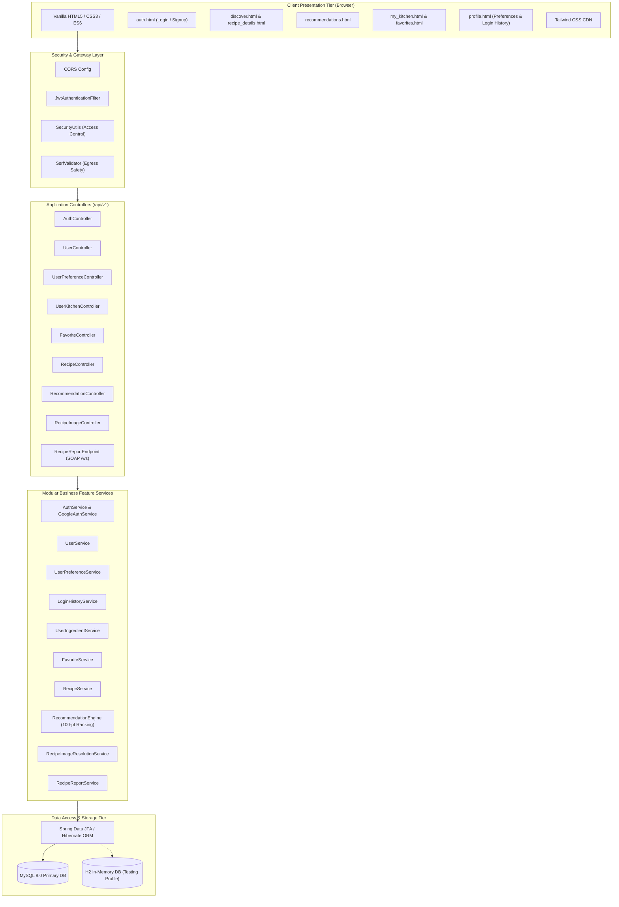

# InChef — System Architecture & Design Documentation

## 1. Architectural Overview

**InChef** is an intelligent Indian recipe recommendation and kitchen pantry management system. It is implemented as a clean, modular Spring Boot 3 monolith paired with a responsive, vanilla HTML/CSS/JavaScript frontend. The system operates directly against a relational MySQL 8 schema without requiring heavy external ML clusters, vector databases, or third-party paid embedding services.



---

## 2. Core Architecture Principles

1. **Separation of Workflows:**
   - **Workflow A (Direct Dish Search):** Bypasses ingredient tokenization and scoring completely. Performs fast, case-insensitive partial match queries over title and translated title fields using indexed relational SQL queries.
   - **Workflow B (Ingredient-Based Recommendation):** Executes multi-stage culinary pipeline with strict token-boundary matching, configurable 75% coverage threshold, allergy exclusion, and explainable 100-point score breakdown.

2. **Modular Business Feature Packaging:**
   All backend code is organized into cohesion-focused domain packages (`auth`, `user`, `preference`, `loginhistory`, `ingredient`, `pantry`, `favorite`, `recipe`, `recommendation`, `recipeimage`, `dataset`, `soap`, `common`, `config`, `security`, `exception`) instead of generic technical layers.

3. **Multi-Tenant Data Privacy & Authorization:**
   - Client-supplied user IDs in URLs (e.g. `/api/v1/users/{userId}/...`) are strictly cross-verified against the authenticated `UserPrincipal` extracted from the verified JWT.
   - Cross-user data access attempts return `403 Forbidden`.
   - Anonymous access attempts to protected endpoints return `401 Unauthorized`.

4. **Resilient Image Extraction & Proxy Pipeline:**
   - Multi-strategy image resolution pipeline (A: Canonical scraped image -> B: Custom Search API -> C: High-res crawl -> D: Local neutral SVG fallback).
   - SSRF protection prevents outbound requests to private IPs (`10.0.0.0/8`, `192.168.0.0/16`, `127.0.0.1`, cloud metadata endpoints `169.254.169.254`).

---

## 3. Package Structure

```text
com.inchef/
├── InChefApplication.java          # Spring Boot main entrypoint
├── auth/                           # Authentication, JWT issue, Google OAuth
├── user/                           # User account management
├── preference/                     # Dietary, spice, cuisine, time preferences
├── loginhistory/                   # User login audit history & session events
├── ingredient/                     # Canonical ingredient dictionary
├── pantry/                         # User kitchen ingredient inventory
├── favorite/                       # User bookmarked recipe collection
├── recipe/                         # Recipe domain, ingredients, cooking progress
├── recommendation/                 # Multi-factor ranking engine & scoring
├── recipeimage/                    # Image resolution, crawler, audit, proxy
├── dataset/                        # Startup sample dataset initialization
├── soap/                           # SOAP web service reporting endpoint
├── common/                         # Shared DTOs, aspects, utilities
├── config/                         # Security, CORS, WebService configurations
├── security/                       # JWT token provider, authentication filter
└── exception/                      # Global exception handler & error models
```

---

## 4. Operational Profiles

- **`mysql` Profile (Production / Local Dev):** Connects to MySQL 8 on `localhost:3306` with persistent storage.
- **`h2` Profile (Automated Testing):** Boots an in-memory H2 database (`jdbc:h2:mem:inchef_db;MODE=MySQL`) with automated schema generation, executing isolated unit and integration tests without external service dependencies.

