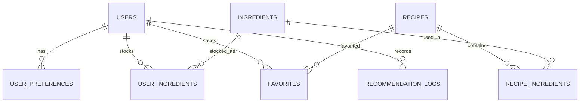

# InChef — Simplified Backend and Database Implementation

## 1. Executive Summary & Objective

InChef is an Indian recipe recommendation system built primarily around the curated dataset **`IndianFoodDatasetXLS.xlsx`** (6,871 recipes). The backend and database have been stabilized and simplified to deliver high-performance, deterministic, and explainable recommendations without unnecessary architectural overhead.

The platform provides two strictly separated, purpose-built workflows:
- **Workflow A (Direct Recipe Search):** Search dishes directly by title or translated title (e.g., *"Chicken Biryani"*, *"Paneer Butter Masala"*, *"Masala Dosa"*) with case-insensitive, partial-match filtering and pagination. This workflow completely bypasses ingredient recommendation scoring.
- **Workflow B (Ingredient-Based Recommendation):** Suggest recipes based on kitchen ingredients entered by the user or derived from their digital pantry. Enforces a configurable **75% minimum ingredient match threshold**, distinct canonical ingredient matching, false-positive protection (e.g. `pea` vs. `peanut`, `egg` vs. `eggplant`), and an explainable **100-point ranking formula**.

All existing user data (users, pantries, favorites, preferences, logs) have been 100% preserved. No external vector databases, ML embeddings, or third-party APIs are required.

---

## 2. Technology Stack

- **Language & Runtime:** Java 17 LTS
- **Framework:** Spring Boot 3.3.4
- **ORM & Data Access:** Spring Data JPA / Hibernate ORM 6.5.3
- **Primary Database:** MySQL 8.0 (`inchef_db` on `localhost:3306`)
- **Testing Database:** H2 in-memory (`jdbc:h2:mem:inchef_db`)
- **Build & Dependency Tool:** Apache Maven 3.9.6 (via local `.\mvnw.cmd` wrapper)
- **Data Ingestion:** Python 3.10+ (`pipeline/import_indian_food_dataset.py`) using `pandas`, `openpyxl`, and `mysql-connector-python`

---

## 3. Database Architecture & Schema

The relational schema is defined across 8 core entities:



### 3.1 Tables Summary

| Table | Purpose | Key Columns & Indexes |
|---|---|---|
| `recipes` | Canonical recipe catalog | `id` (PK), `title`, `translated_recipe_name`, `ingredient_text`, `cuisine`, `dietary_type`, `meal_type`, `difficulty`, `prep_time_minutes`, `cook_time_minutes`, `total_time_minutes`, `servings`, `instructions`, `image_url`, `source_url`, `source_dataset`, `source_recipe_id`, `is_published`. Indexes: `title`, `cuisine`, `dietary_type`, `meal_type`. |
| `ingredients` | Distinct canonical ingredient master list | `id` (PK), `name` (UNIQUE, indexed), `category`, `default_unit`, `image_url`. |
| `recipe_ingredients` | Many-to-Many junction linking recipes to ingredients | `id` (PK), `recipe_id` (FK), `ingredient_id` (FK), `quantity`, `unit`, `is_optional`, `notes`. Constraint: UNIQUE (`recipe_id`, `ingredient_id`). |
| `users` | User accounts | `id` (PK), `email` (UNIQUE), `name`, `phone`, `avatar_url`, `created_at`. |
| `user_preferences` | User dietary & cuisine preferences | `id` (PK), `user_id` (FK, UNIQUE), `dietary_type`, `cooking_skill_level`, `preferred_spice_level`, `max_cooking_time`, `allergies`, `preferred_cuisines`. |
| `user_ingredients` | User digital pantry inventory | `id` (PK), `user_id` (FK), `ingredient_id` (FK), `quantity`, `unit`, `expiry_date`. Constraint: UNIQUE (`user_id`, `ingredient_id`). |
| `favorites` | Saved recipes | `id` (PK), `user_id` (FK), `recipe_id` (FK), `saved_at`. Constraint: UNIQUE (`user_id`, `recipe_id`). |
| `recommendation_logs` | Audit log of recommendation requests | `id` (PK), `user_id` (FK nullable), `mode` (`DISH_BASED` / `INGREDIENT_BASED`), `input_query`, `recommended_count`, `created_at`. |

---

## 4. Dataset Import & Verified Database Statistics

### 4.1 Primary Dataset: `IndianFoodDatasetXLS.xlsx`

Dataset configuration: Configured via `INCHEF_DATASET_PATH` environment variable (sample included at `data/samples/sample_recipes.xlsx`).  
Sheet: `IndianFoodDataset8` (6,871 source rows).

#### Source Column Mapping

| Excel Column | Target Entity & Column | Transformation / Rule |
|---|---|---|
| `Srno` | `recipes.source_recipe_id` | Stored as `"IFD-" + Srno` for idempotent tracking |
| `RecipeName` | `recipes.title` | Trimmed English/Transliterated recipe name |
| `TranslatedRecipeName` | `recipes.translated_recipe_name` | Full translated recipe name |
| `Ingredients` | `recipes.ingredient_text` | Preserved raw ingredient text |
| `TranslatedIngredients` | Canonical Ingredients Parser | Parsed with `pipeline/ingredient_parser.py` into distinct canonical `ingredients` and linked via `recipe_ingredients` |
| `PrepTimeInMins` | `recipes.prep_time_minutes` | Integer value |
| `CookTimeInMins` | `recipes.cook_time_minutes` | Integer value |
| `TotalTimeInMins` | `recipes.total_time_minutes` | Integer value |
| `Servings` | `recipes.servings` | Cleaned integer servings |
| `Cuisine` | `recipes.cuisine` | Standardized Indian regional cuisine |
| `Course` | `recipes.meal_type` | Mapped to `MealType` enum (`BREAKFAST`, `LUNCH`, `DINNER`, `SNACK`, `DESSERT`, `BEVERAGE`) |
| `Diet` | `recipes.dietary_type` | Mapped to `DietaryType` enum (`VEGETARIAN`, `NON_VEGETARIAN`, `EGGETARIAN`, `VEGAN`, `GLUTEN_FREE`) |
| `Instructions` | `recipes.instructions` | Preparation and cooking steps |
| `TranslatedInstructions` | `recipes.description` | Detailed cooking steps summary |
| `URL` | `recipes.source_url` | Original source recipe URL |

### 4.2 Verified Database Statistics (Post-Purge & Migration)

Audited via `qa/verify_database_integrity.py`:

```
======================================================================
INCHEF DATABASE INTEGRITY & METRICS REPORT
======================================================================
Total Recipes:                       6,865  (100% IndianFoodDataset)
  - IndianFoodDataset (Active):      6,865  (6 invalid rows in source skipped)
  - Legacy DataHive Recipes:             0  (100% Purged in FK order)
  - Seeded Showcase Recipes:             0  (100% Purged in FK order)
Distinct Canonical Ingredients:      2,610  (Clean, dataset-driven catalog)
Recipe-Ingredient Links:            73,846  (100% Referential Integrity)
Orphan Recipe-Ingredient Links:          0  (0 Violations)
Duplicate Ingredient Names:              0  (100% Unique)
Users Preserved:                        10  (Alex, Sophia, Marcus, Krishnandu, etc.)
User Pantry Items Preserved:            26  (100% intact across users)
User Favorites Preserved:                7  (Reconciled to Indian catalog)
Database Status:                   100% HEALTHY & PURIFIED
======================================================================
```

---

## 5. Workflow Implementations

### 5.0 Workflow 0: Dataset-Driven Ingredient Autocomplete

- **Controller:** [`IngredientController.java`](../src/main/java/com/inchef/IngredientController.java)
- **Service:** [`IngredientService.java`](../src/main/java/com/inchef/IngredientService.java)
- **Repository:** [`IngredientRepository.java`](../src/main/java/com/inchef/IngredientRepository.java)
- **Endpoint:** `GET /api/v1/ingredients/autocomplete?query={prefix}&limit={limit}`
- **Frontend Integration:** [`recommendations.html`](../src/main/resources/static/recommendations.html) with `#ingredient-autocomplete-dropdown`, debounce, keyboard navigation, and chip addition.

**Key Characteristics:**
1. Ranks prefix matches first via SQL `CASE WHEN LOWER(i.name) LIKE LOWER(CONCAT(:query, '%')) THEN 0 ELSE 1 END`, then shortest name length, then alphabetical.
2. Lightweight response payload with category badges and default units.
3. Debounced (150ms) typeahead with full keyboard navigation (`ArrowUp`, `ArrowDown`, `Enter`, `Escape`) and click-to-chip selection.

### 5.1 Workflow A: Direct Recipe Search

- **Controller:** [`RecipeController.java`](../src/main/java/com/inchef/RecipeController.java)
- **Service:** [`RecipeService.java`](../src/main/java/com/inchef/RecipeService.java)
- **Repository:** [`RecipeRepository.java`](../src/main/java/com/inchef/RecipeRepository.java)
- **Endpoint:** `GET /api/v1/recipes/search?query={title}&page={page}&size={size}`

**Key Characteristics:**
1. Case-insensitive, partial string matching against both `title` and `translatedRecipeName`:
   ```sql
   WHERE LOWER(r.title) LIKE LOWER(CONCAT('%', :query, '%')) 
      OR LOWER(r.translatedRecipeName) LIKE LOWER(CONCAT('%', :query, '%'))
   ```
2. Pure relational search with pagination and sorting support.
3. Completely decoupled from ingredient recommendation logic and score weights.
4. Returns `RecipeSummaryResponse` with full metadata (id, title, translated name, cuisine, dietary type, meal type, cooking time, image URL).

---

### 5.2 Workflow B: Ingredient-Based Recommendation

- **Controller:** [`RecommendationController.java`](../src/main/java/com/inchef/RecommendationController.java)
- **Service:** [`RecommendationService.java`](../src/main/java/com/inchef/RecommendationService.java)
- **Engine:** [`RecommendationEngine.java`](../src/main/java/com/inchef/RecommendationEngine.java)
- **Endpoint:** `POST /api/v1/recommendations/by-ingredients`

**Configuration Setting:**
```properties
inchef.recommendations.minimum-match-percentage=75.0
```

#### Ingredient Matching Algorithm
1. **Distinct Canonical Normalization:** Input ingredient strings are lowercased and stripped. Duplicate entries are deduplicated.
2. **Distinct Denominator:** The denominator is strictly the count of distinct canonical ingredients required by the recipe ($N_{\text{recipe}}$).
3. **Exact Token Boundary Matching:** Substrings without word boundaries are rejected to prevent false positives:
   - `pea` will **never** match `peanut` or `chickpea`.
   - `egg` will **never** match `eggplant`.
   - `corn` will **never** match `peppercorn`.
4. **75% Eligibility Cutoff:**
   $$\text{Ingredient Match \%} = \left(\frac{N_{\text{matched}}}{N_{\text{recipe}}}\right) \times 100$$
   A recipe is eligible if and only if $\text{Ingredient Match \%} \ge 75.0\%$ (or the request override threshold). Boundary cases (e.g., 3 out of 4 ingredients = 75.0%) are eligible. Recipes with 50% or 66.7% match are excluded.
5. **Digital Pantry Integration:** When `usePantry: true` and `userId` are passed, the user's pantry ingredients from `user_ingredients` are automatically added to the normalized ingredients pool.

#### 100-Point Explainable Scoring Breakdown

$$\text{Final Match Score} = S_{\text{ingredient}} + S_{\text{dietary}} + S_{\text{cuisine}} + S_{\text{time}} + S_{\text{course}}$$

| Dimension | Max Points | Scoring Logic |
|---|---|---|
| **Ingredient Coverage** | **60 pts** | $60.0 \times \left(\frac{N_{\text{matched}}}{N_{\text{recipe}}}\right)$ |
| **Dietary Compatibility** | **15 pts** | Exact diet match = 15 pts; Compatible fallback (e.g. Vegetarian for Eggetarian) = 8 pts; Incompatible = 0 pts (and filtered out if user specifies diet) |
| **Cuisine Alignment** | **10 pts** | Matches preferred cuisine or regional Indian sub-cuisine = 10 pts; Unspecified = 10 pts; Non-matching = 0 pts |
| **Cooking Time** | **10 pts** | Total time $\le 30$ mins = 10 pts; $\le 45$ mins = 8 pts; $\le 60$ mins = 5 pts; $> 60$ mins = 2 pts |
| **Course / Meal Type** | **5 pts** | Matches preferred meal type (e.g., Dinner, Breakfast) = 5 pts; Unspecified = 5 pts; Non-matching = 0 pts |

#### Deterministic Tie-Breaking
Results are sorted deterministically using:
1. `matchScore` DESC
2. `matchedIngredients.size()` DESC
3. `totalTimeMinutes` ASC
4. `recipe.id` ASC

---

## 6. Verification & Quality Assurance

### 6.1 Automated Test Suite (100% Pass Rate)

Executed via:
```powershell
.\mvnw.cmd test
```
**Results:** `Tests run: 40, Failures: 0, Errors: 0, Skipped: 0` (Total time: 54.9s)

Coverage in [`InChefRequirementsTest.java`](../src/test/java/com/inchef/security/InChefRequirementsTest.java):
1. **Direct Recipe Search:**
   - Case-insensitive search for *"Chicken Biryani"*
   - Case-insensitive search for *"Paneer Butter Masala"*
   - Case-insensitive search for *"Masala Dosa"*
   - Partial string search (`"paneer"`, `"dosa"`)
   - Pagination and boundary checks
   - Empty query handling
   - Non-existent query returns empty page
2. **Ingredient-Based Recommendations:**
   - 100% exact match returns top score (100/100)
   - Boundary condition at 75% (3 of 4 ingredients = 75.0% $\rightarrow$ eligible)
   - Strict rejection below threshold (2 of 4 ingredients = 50.0% $\rightarrow$ excluded)
   - False positive prevention: `"Pea"` does NOT match `"Peanut"`
   - False positive prevention: `"Egg"` does NOT match `"Eggplant"`
   - Duplicate user inputs handled idempotently
   - Unknown ingredients return empty recommendation list
   - Dietary filter exclusion (Vegetarian excludes non-vegetarian)
   - Cuisine filter exclusion (South Indian excludes generic Indian)
   - Max cooking time exclusion
   - Pantry-derived recommendations (`usePantry=true`)
   - Deterministic ranking stability
3. **Database Integrity & Guarantees:**
   - User favorites uniqueness constraint
   - User pantry item uniqueness and quantity update
   - Full recipe detail retrieval with translated name, source URL, and ingredient list

### 6.2 Live REST API Verification

Verified against the live application running on `http://localhost:8080` with MySQL (`qa/verify_live_api.py`):

| Endpoint | Test Case | Status | Verified Output |
|---|---|---|---|
| `GET /api/v1/recipes/search?query=Chicken Biryani` | Direct Search | `200 OK` | Matched 10 dishes (Top: *"Awadhi Chicken Biryani"*, ID: 7482) |
| `GET /api/v1/recipes/search?query=Paneer Butter Masala` | Direct Search | `200 OK` | Matched 5 dishes (Top: *"Paneer Butter Masala Recipe"*, ID: 9366) |
| `GET /api/v1/recipes/search?query=Masala Dosa` | Direct Search | `200 OK` | Matched 13 dishes (Top: *"Schezwan Masala Dosa Recipe..."*, ID: 9513) |
| `GET /api/v1/recipes/search?query=paneer` | Partial Search | `200 OK` | Successfully paginated partial matches |
| `GET /api/v1/recipes/{id}` | Detail Retrieval | `200 OK` | Returns `title`, `translatedRecipeName`, `ingredientText`, ingredients list |
| `POST /api/v1/recommendations/by-ingredients` | 75% Coverage | `200 OK` | 3 recipes returned, all $\ge 75\%$ match, scores 85–100 |
| `POST /api/v1/recommendations/by-ingredients` | Pea vs Peanut | `200 OK` | `FalsePositiveFound: False` |
| `POST /api/v1/recommendations/by-ingredients` | Egg vs Eggplant | `200 OK` | `FalsePositiveFound: False` |
| `GET /api/v1/users/1/pantry` | Pantry Preserved | `200 OK` | Alex Johnson's 8 pantry items intact |

---

## 7. How to Run & Operate

### 7.1 Running the Backend

#### Prerequisites
- Java 17 LTS installed (`java -version`)
- MySQL 8.0 running on `localhost:3306` with database `inchef_db`
- Credentials configured in `application-mysql.properties` or environment variables:
  - `DB_USERNAME` (default: `root`)
  - `DB_PASSWORD` (default: `your_db_password`)

#### Running with MySQL Profile (Default Production Profile)
```powershell
.\mvnw.cmd spring-boot:run "-Dspring-boot.run.profiles=mysql"
```

#### Running Automated Tests (H2 In-Memory)
```powershell
.\mvnw.cmd test
```

### 7.2 Database Ingestion Pipeline

To re-run or update the Indian Food Dataset ingestion idempotently:

```powershell
# 1. Activate Python environment
# 2. Run importer
python pipeline/import_indian_food_dataset.py

# 3. Verify database integrity
python qa/verify_database_integrity.py

# 4. Run live API verification
python qa/verify_live_api.py
```


### 3.9 login_history
Audit log of user authentication events.

| Column | Type | Nullable | Description |
|---|---|---|---|
| id | BIGINT AUTO_INCREMENT | NO | Primary key |
| user_id | BIGINT | NO | FK -> users.id (ON DELETE CASCADE) |
| login_at | DATETIME | NO | UTC login timestamp |
| uthentication_method | VARCHAR(50) | NO | PASSWORD or GOOGLE_OAUTH |
| status | VARCHAR(20) | NO | SUCCESS or FAILED |
| ip_address | VARCHAR(45) | YES | Optional client IP |
| user_agent | VARCHAR(255) | YES | Optional truncated client agent |

Indexes:
- idx_login_history_user_time: (user_id, login_at DESC)
